<p align="center">
  
</p>

```console
dion@github:~$ cat sobre.txt
```

> Sou desenvolvedor **Full Stack**, adepto ao uso de **TypeScript** em toda a stack
> e à construção de sistemas baseados em **DDD (Domain-Driven Design)**, sempre
> buscando código limpo, bem estruturado e de fácil manutenção.
>
> No frontend, trabalho com **React**, desenvolvendo interfaces modernas,
> performáticas e focadas na experiência do usuário. No backend, utilizo **Bun** e
> **Elysia** para construir APIs escaláveis, aplicando arquitetura em camadas e boas
> práticas que facilitam a evolução e a consistência dos sistemas.

```console
dion@github:~$ ls ~/stack
```

<p align="center">
  
</p>

```console
dion@github:~$ gh stats --user Dionromero
```

<p align="center">
  
</p>

```console
dion@github:~$ cat ~/.contatos
```

<p align="center">
  <a href="https://linkedin.com/in/dion-romero-347643296" target="_blank">
    
  </a>
  &nbsp;&nbsp;
  <a href="https://www.instagram.com/dion_alcantara/" target="_blank">
    
  </a>
  &nbsp;&nbsp;
  <a href="mailto:dionalcantara20@gmail.com">
    
  </a>
</p>

```console
dion@github:~$ exit
```
